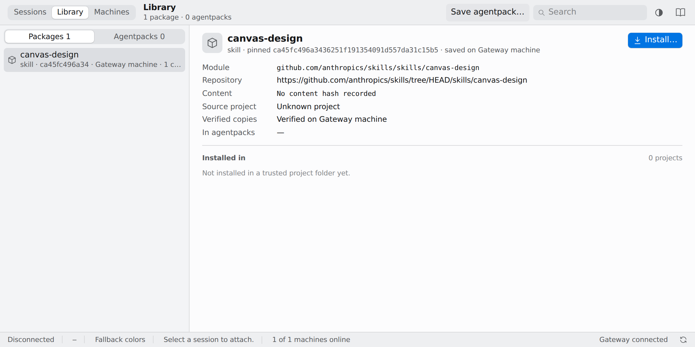

<h1> Agentpack</h1>

Pin skills, plugins and MCP servers for your coding agents in one project. Agentpack records the resolved packages in `pack.lock` and stages them for Claude Code, Cursor, OpenCode, Codex, Grok and Antigravity.

[](docs/demo/control-plane.png)

## Install

macOS and Linux:

```sh
curl --proto '=https' --tlsv1.2 -LsSf https://github.com/olegpustovit/agentpack/releases/latest/download/agentpack-installer.sh | sh
```

Windows PowerShell:

```powershell
irm https://github.com/olegpustovit/agentpack/releases/latest/download/agentpack-installer.ps1 | iex
```

macOS Homebrew:

```sh
brew install --cask olegpustovit/tap/agentpack
```

Check the installation with `agentpack --version`. The scripts install to `~/.local/bin` without changing your PATH; add that directory to your PATH if the command is not found. See [installation](docs/src/getting-started/installation.md) for archives, checksums, source builds and pinned versions.

## Get started

In your project, initialize a manifest and add a skill from GitHub:

```sh
agentpack init
agentpack add anthropics/skills/skills/canvas-design
agentpack sync
```

Commit `agentpack.toml` and `pack.lock` to share the same pins with your team. Install and sign in to your coding agent separately, then launch it from the project:

| Command | Agent |
| --- | --- |
| `agentpack claude` | Claude Code |
| `agentpack agent` | Cursor Agent |
| `agentpack opencode` | OpenCode |
| `agentpack codex` | Codex |
| `agentpack grok` | Grok |
| `agentpack omp` | Oh My Pi |
| `agentpack agy` | Antigravity |

Arguments after the launcher are passed to the agent. See the [quick start](docs/src/getting-started/quick-start.md) and [harness guides](docs/src/harnesses/claude.md) for details.

## Control plane

Agentpack's gateway lets you view and control sessions in a browser and manage your package library. Start the local gateway and set up its first account:

```sh
agentpack gateway start
agentpack gateway setup
```

Open the URL printed by setup and enter its one-time token. Normal agent launches also start a local node automatically. See [gateway services](docs/src/guides/gateway-services.md) for startup and sharing, and [gateway deployment](docs/src/guides/gateway-deployment.md) for a public server.

## Learn more

- [Documentation](https://olegpustovit.github.io/agentpack/) · [Manifest](docs/src/getting-started/first-manifest.md) · [Modes](docs/src/concepts/modes.md) · [MCP](docs/src/concepts/mcp.md)
- [Staging and integrity](docs/src/concepts/staging.md) · [Local skill demo](docs/demo/README.md) · [DevFest walkthrough](docs/demo/devfest.md)
- [ICSE evaluation](docs/src/guides/icse-evaluation.md) and [recorded results](evaluation/icse2027/README.md)
- [Contributing guidance](AGENTS.md) · [MIT license](LICENSE)

Agentpack is pre-release software: CLI behavior, lockfiles and staging layouts may change between versions. The experimental proxy credits [raine/claude-code-proxy](https://github.com/raine/claude-code-proxy).
