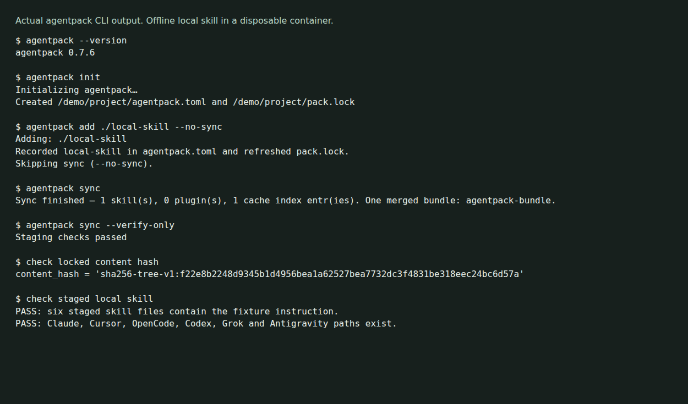

# agentpack

Pin skills and plugins for coding agents in one project manifest. Agentpack resolves packages, records commits and content hashes in a lockfile, and stages supported artifacts for Claude Code, Cursor, OpenCode, Codex, Grok and Antigravity.



*Actual CLI output from a local skill in a disposable, network-disabled container. This checks package staging, not an agent's response to the skill.*

## Install

Download an archive for your platform from [GitHub releases](https://github.com/olegpustovit/agentpack/releases/latest), check it against the release's `checksums.txt`, extract it and put `agentpack` on your PATH. Release targets are macOS and Linux on ARM64/x86-64, plus Windows x86-64.

[Installer scripts, Homebrew and source-build instructions](docs/README-reference.md#install) describe the other options. The source build requires Go 1.26 or newer:

```sh
git clone https://github.com/olegpustovit/agentpack.git
cd agentpack
go build -o ./agentpack ./cmd/agentpack
./agentpack --version
```

This is pre-release software. CLI behavior, lockfiles and staging layouts can change between versions.

## Try a local skill

With agentpack on your PATH, run this in a new directory:

```sh
mkdir agentpack-demo
cd agentpack-demo
agentpack init
mkdir local-skill
cat > local-skill/SKILL.md <<'SKILL'
---
name: local-skill
description: Summarize a change and explain how to verify it.
---
Describe the change in plain language. Include the verification command.
SKILL
agentpack add ./local-skill --no-sync
agentpack sync
agentpack sync --verify-only
```

You now have `agentpack.toml`, `pack.lock` and staged copies of the skill. The lock records a content hash. A local path dependency follows your directory's contents when you lock or sync; it does not freeze the source directory. [Demo commands, output and assertions](docs/demo/README.md) show the checked run.

For a GitHub package, use a repository or subdirectory spec such as `agentpack add anthropics/skills/skills/canvas-design`. Review the content and lockfile changes before launching it. Commit both the manifest and lockfile if the project should share those dependencies.

## Launch an installed agent

Run one launcher from your project. Install and authenticate the underlying agent separately.

| Command | Agent |
| --- | --- |
| `agentpack claude` | Claude Code |
| `agentpack agent` | Cursor Agent |
| `agentpack opencode` | OpenCode |
| `agentpack codex` | Codex |
| `agentpack grok` | Grok |
| `agentpack agy` | Antigravity |

Arguments after the launcher are forwarded to that agent. Staging an artifact does not establish that every agent discovers it or follows its instructions. [Harness guides](https://olegpustovit.github.io/agentpack/harnesses/claude.html) describe the adapters; the [conversion table](docs/README-reference.md#cross-harness-artifact-conversion) lists fallbacks.

## Files and verification limits

Downloaded content and metadata live under `AGENTPACK_HOME`, normally `~/.local/share/agentpack` on Unix, or an XDG/Windows data location. Staging is per project. Previous generations are retained for active sessions and can consume disk space.

The manifest and lockfile are project files by default. Cursor and Antigravity launchers can add workspace links; `eject` deliberately writes staged content into a project. Some adapters copy or link user configuration and synchronize session or authentication state. Read the [staging guide](docs/src/concepts/staging.md) before treating this as an isolated environment.

A full sync verifies hashed cache entries. An unchanged launch can take a metadata-based fast path; set `AGENTPACK_FULL_VERIFY=1` to hash cached content on every launch. Legacy lock entries without hashes are allowed with warnings unless `AGENTPACK_REQUIRE_VERIFIED=1` is set. `sync --verify-only` checks staged files. Hashes detect changes to locked content; they do not establish that its instructions or executable hooks are safe.

MCP pinning depends on the launcher and recorded status. Complete dependency-tree locking is limited to supported npx cases. Other runners may pin only a top-level package or remain unpinned. See [MCP limits](docs/src/concepts/mcp.md#limits).

## Documentation and development

Use `agentpack --help` for the command list. The [documentation site](https://olegpustovit.github.io/agentpack), [manifest guide](docs/src/getting-started/first-manifest.md), [modes](docs/src/concepts/modes.md), [external environments](docs/src/concepts/environments.md) and [installation/reference](docs/README-reference.md) cover the detailed workflows, including the experimental proxy.

Contributors should read [AGENTS.md](AGENTS.md). Run `make test` and `make lint` for Go checks. Preview the book with `mdbook serve docs`. [Evaluation notes](docs/src/guides/icse-evaluation.md) distinguish package integrity, native discovery and model behavior.

## License

[MIT](LICENSE). Experimental proxy work credits [raine/claude-code-proxy](https://github.com/raine/claude-code-proxy).
